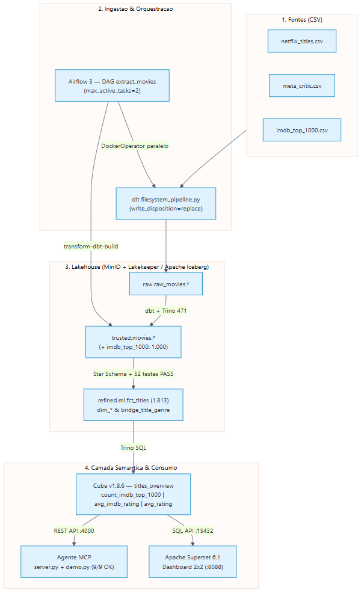
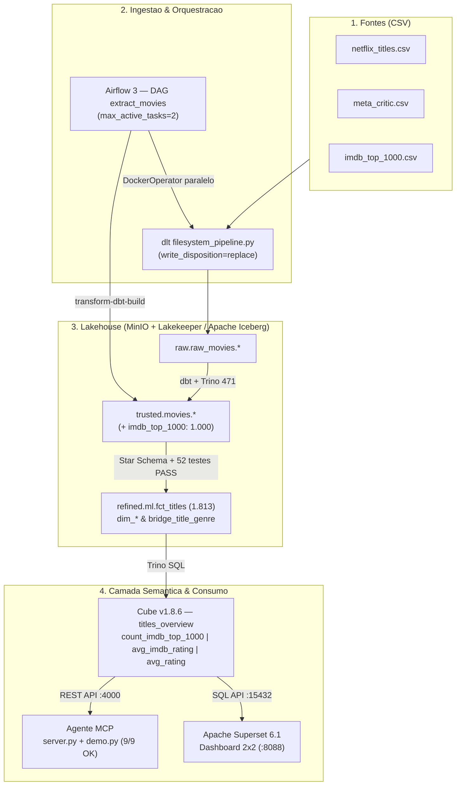
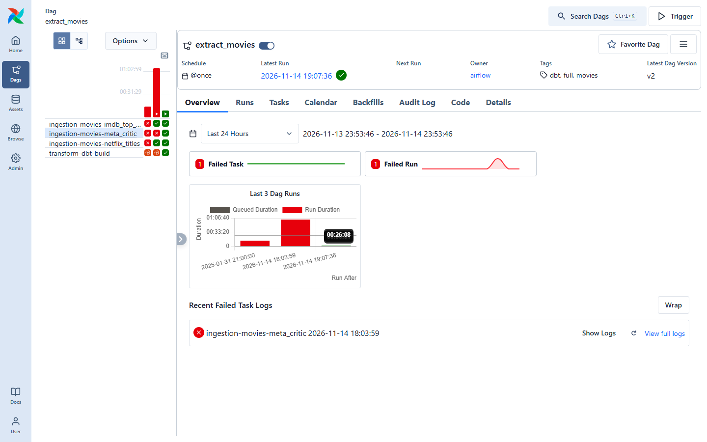
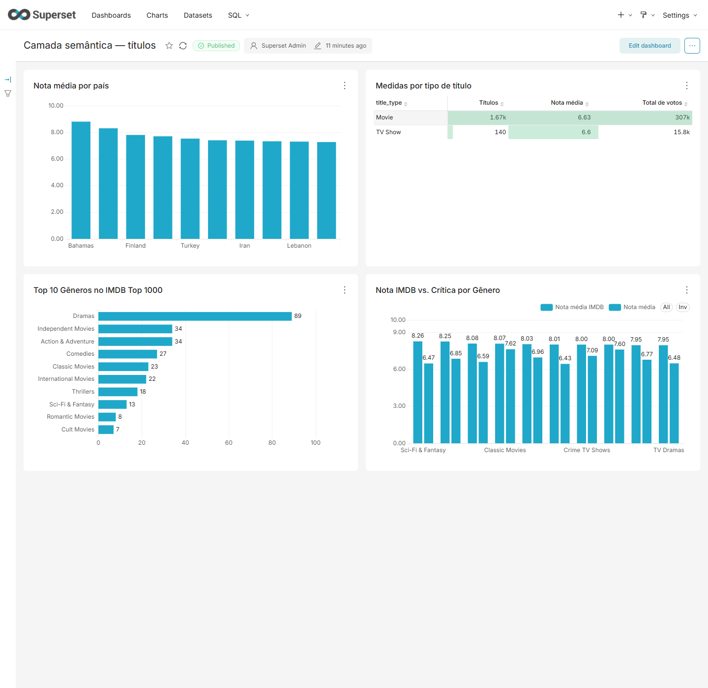

# Relatório Técnico — Atividade Final: Data Engineering & Architecture

- **Curso:** MBA em Arquitetura de Sistemas Digitais — Faculdade Impacta
- **Disciplina:** Data Engineering & Architecture
- **Aluno:** Renan Baisso
- **Professor:** Lorran Santos Rodrigues
- **Data:** 15/11/2026
- **Repositório:** [https://github.com/r-baisso/mba-data-engineering-platform](https://github.com/r-baisso/mba-data-engineering-platform)

---

## 1. O que foi feito e por quê

### Pergunta de negócio
> *"Quais gêneros da Netflix têm mais títulos no Top 1000 do IMDB, e como a nota do público (IMDB) se compara à nota da crítica (Metacritic)?"*

### Objetivo e motivação
Na plataforma original (`toy-data-platform`), o dataset `imdb_top_1000.csv` já era ingerido pelo `dlt` para `raw.raw_movies.imdb_top_1000`, mas não era transformado no `dbt` nem exposto no `Cube`, no `Superset` ou no servidor `MCP`. Além disso, a DAG `extract_movies` no Airflow encadeava as três ingestões em fila (`chain(*tasks)`) e não disparava a transformação `dbt`.

A plataforma foi evoluída de forma incremental (em ciclo *Spec-Driven Development*, documentado em `docs/specs/`) cobrindo transformação/modelagem, qualidade, orquestração, camada semântica e consumo.

### Arquitetura da Solução


> **Versão interativa e responsiva (HTML):** [`docs/arquitetura-solucao.html`](./arquitetura-solucao.html) (permite filtrar camadas, buscar tabelas/métricas e inspecionar cada componente no navegador).

<details>
<summary>Ver diagrama em Mermaid (renderização nativa no GitHub)</summary>



</details>

---

## 2. Como foi feito

### 2.1 Transformação, Modelagem e Qualidade (`dbt` + Trino/Iceberg)
- **`trusted/movies/imdb_top_1000.sql` e `schema.yml`:** Declarado `imdb_top_1000` como `source` (`raw.raw_movies`) e criado o modelo `trusted` no grão 1:1 da origem, padronizando `title`, `released_year` (validando 4 dígitos com `regexp_like` em vez de `TRY_CAST` silencioso), `imdb_rating`, `imdb_votes` e `gross_usd` (removendo separadores de milhar). Adicionados testes `not_null` em `title`, `imdb_rating` e `imdb_votes`.
- **`refined/ml/fct_titles.sql` e `schema.yml`:** Enriquecido o fato `fct_titles` mantendo o grão original (`1 linha = 1 title_key`, `1813` títulos) via `LEFT JOIN` com o IMDB Top 1000 deduplicado deterministicamente (`row_number()` ordenado por `imdb_votes desc, released_year desc`), expondo `imdb_rating`, `imdb_votes` e `is_imdb_top_1000`.
  - *Alternativa considerada:* Criar uma segunda tabela fato exclusiva para o IMDB. Optou-se por enriquecer `fct_titles` via `LEFT JOIN` para preservar uma única tabela fato e reutilizar as pontes `bridge_title_genre` e `bridge_title_country` sem duplicar joins.
- **Testes de contrato:** Adicionado `accepted_values` (`[0, 1]`, `quote: false`) em `is_imdb_top_1000` e o teste singular `tests/assert_fct_titles_imdb_rating_range.sql` garantindo notas no intervalo `[0, 10]`.

```sql
-- Trecho de dbt/movies_transform/models/refined/ml/fct_titles.sql
imdb as (
    select
        lower(trim(title)) as title_key,
        imdb_rating,
        imdb_votes,
        row_number() over (
            partition by lower(trim(title))
            order by imdb_votes desc, released_year desc
        ) as rn
    from {{ ref('imdb_top_1000') }}
)
-- ... LEFT JOIN mantendo o grão de 1 título por linha:
left join imdb i on n.title_key = i.title_key and i.rn = 1
```

### 2.2 Orquestração (`Airflow` + `DockerOperator`)
- **`dbt/Dockerfile`:** Empacotado `COPY movies_transform /usr/app/movies_transform` na imagem `movies_transform:latest` para que o `DockerOperator` execute de forma reprodutível sem depender de caminhos de *bind mount* do host Windows/WSL2.
- **`airflow/dags/extract_movies.py`:** Substituído `chain(*tasks)` pela execução paralela das 3 tarefas `dlt` convergindo para `transform-dbt-build` (`ingestion_tasks >> dbt_build_task`), com `max_active_tasks=2` e `retries=1`.

```python
# Trecho de airflow/dags/extract_movies.py
dbt_build_task = DockerOperator(
    docker_url="unix://var/run/docker.sock",
    image="movies_transform:latest",
    command=["dbt", "build", "--no-partial-parse", "--target-path", "target/prod"],
    network_mode="container:airflow_scheduler",
    task_id="transform-dbt-build",
    auto_remove="force",
    retries=1,
    dag=dag,
    environment={"DBT_PARTIAL_PARSE": "false"},
)
ingestion_tasks >> dbt_build_task
```

### 2.3 Camada Semântica (`Cube`) e Consumo (`Superset` & `MCP`)
- **`cube/model/cubes/titles.yml` e `views/titles_overview.yml`:** Definidas as medidas `count_imdb_top_1000` (`type: sum`, `sql: is_imdb_top_1000`) e `avg_imdb_rating` (`type: avg`, `sql: imdb_rating`) no cubo `titles` e expostas na view `titles_overview`. Graças ao `primary_key: title_key` (garantido pelo teste `unique` do dbt), o Cube evita *fan trap* ao fatiar por gênero via `bridge_title_genre`.
- **`superset/bootstrap_semantic_layer.py`:** Registradas `MEASURE(count_imdb_top_1000)` e `MEASURE(avg_imdb_rating)` no dataset `titles_overview` e adicionados dois gráficos complementares em grid 2x2: `"Top 10 Gêneros no IMDB Top 1000"` (barras horizontais de volume) e `"Nota IMDB vs. Crítica por Gênero"` (barras agrupadas na escala 0–10), evitando distorção de escala entre contagem e nota.
- **`mcp/demo.py`:** Adicionada a pergunta de negócio ao roteiro governado, descobrindo as novas medidas automaticamente via `list_measures()`.

---

## 3. Evidências

### 3.1 `dbt build` e integridade do grão
```text
Done. PASS=52 WARN=0 ERROR=0 SKIP=0 NO-OP=0 REUSED=0 TOTAL=52
```
Consulta no Trino em `refined.ml.fct_titles`:
- `total_rows = 1813`, `distinct_keys = 1813`, `imdb_top_1000_matches = 134`, `avg_imdb_rating = 7.967`.

### 3.2 Teste capturando um erro real
Foi inserida temporariamente uma linha inválida (`imdb_rating = 15.0`) em `refined.ml.fct_titles` e executado o teste singular:
```text
INSERT: 1 row
13:10:30  1 of 1 START test assert_fct_titles_imdb_rating_range ................ [RUN]
13:10:42  1 of 1 FAIL 1 assert_fct_titles_imdb_rating_range .................... [FAIL 1 in 12.02s]
13:10:43  [ERROR]: in test assert_fct_titles_imdb_rating_range
  Got 1 result, configured to fail if != 0
Done. PASS=0 WARN=0 ERROR=1 SKIP=0 TOTAL=1
```
Após remover a linha inválida (`DELETE: 1 row`), o mesmo teste voltou a passar:
```text
13:12:17  1 of 1 START test assert_fct_titles_imdb_rating_range ................ [RUN]
13:12:25  1 of 1 PASS assert_fct_titles_imdb_rating_range ...................... [PASS in 7.81s]
Done. PASS=1 WARN=0 ERROR=0 SKIP=0 TOTAL=1
```

### 3.3 Execução da DAG no Airflow e idempotência
Execução `manual__2026-11-14T22:07:36.171053+00:00` da DAG `extract_movies` concluída com `state = success`:
- `ingestion-movies-imdb_top_1000`: `success` (`22:07:42` → `22:08:02`)
- `ingestion-movies-meta_critic`: `success` (`22:07:42` → `22:08:02`, paralelo)
- `ingestion-movies-netflix_titles`: `success` (`22:08:03` → `22:08:20`)
- `transform-dbt-build`: `success` (`22:08:21` → `22:09:26`)
- Revalidação pós-DAG em `refined.ml.fct_titles`: `1813` linhas = `1813` chaves distintas, `134` matches IMDB.



### 3.4 Paridade entre Cube, Superset e Agente MCP
- **Cube SQL API (`psql` na porta `15432`):**
  - Global: `titulos = 1813`, `imdb_top_1000 = 134`, `nota_imdb = 7.967`, `nota_critica = 6.625`.
  - Top gêneros: `Dramas` (`89` títulos, IMDB `7.952` vs. crítica `6.773`), `Action & Adventure` (`34`, `8.082` vs. `6.592`), `Independent Movies` (`34`, `7.871` vs. `6.787`), `Comedies` (`27`, `7.930` vs. `6.471`), `Classic Movies` (`23`, `8.074` vs. `7.623`).
- **Agente MCP (`mcp/demo.py` + `unittest`):**
  - `Ran 9 tests ... OK`
  - Resposta do roteiro governado: `Dramas — 89 títulos no IMDB Top 1000 (nota IMDB 7.952 vs. crítica 6.773).` (exata paridade com o Cube).
- **Superset (`superset-bootstrap`):**
  - `chart: atualizado id=4 (Top 10 Gêneros no IMDB Top 1000)`, `chart: atualizado id=5 (Nota IMDB vs. Crítica por Gênero)` e `dashboard: layout atualizado (id=1)` em grid 2x2 consumindo as mesmas medidas `MEASURE(...)` do Cube.



---

## 4. Dificuldades e soluções

1. **`TYPE_MISMATCH` no Trino com `accepted_values`:** Por padrão, o teste `accepted_values: [0, 1]` do `dbt` gera `IN ('0', '1')` (varchar), falhando contra coluna `integer` no Trino. *Solução:* adicionar `quote: false` na configuração do teste no `schema.yml`.
2. **Pressão de memória no WSL2 (`[Errno 12] Cannot allocate memory` e containers `unhealthy`):** O host possui `6,9 GB` de RAM utilizável e o WSL2 limitava a VM a `3,28 GiB` sem ajuste de swap; ao executar o `partial_parse` do dbt ou 3 containers `dlt` simultâneos junto ao Trino/Airflow/Superset, faltava memória. *Solução:* criação de `.wslconfig` (`memory=4GB`, `swap=4GB`), uso de `DBT_PARTIAL_PARSE=false` / `--no-partial-parse` no dbt e `max_active_tasks=2` na DAG do Airflow.
3. **`LookupError` no `mcp/demo.py`:** O resumo final de `rank_by` no script assumia a presença fixa de `count_titles`. *Solução:* ajuste para formatar o resumo de acordo com a medida de ranking da pergunta.

---

## 5. Uso de IA

Agentes de IA foram utilizados em todo o ciclo:
- **Onde ajudaram:** estruturação das especificações (SDD), diagnóstico rápido dos logs do Trino/dbt/WSL2 e automação da validação ponta a ponta, além de um subagente avaliador independente (`professor-avaliador`) para revisão sem viés.
- **Onde exigiram direcionamento/correção:** adaptação de comandos do `Makefile` (pensados para Linux/Mac) para PowerShell no Windows, ajuste fino de memória do WSL2 e correção de detalhes específicos de dialeto (como `quote: false` no Trino e `max_active_tasks` na DAG).

---

## 6. Aprendizados

- **O grão sustenta toda a plataforma:** Declarar o grão (`1 título`) na `fct_titles`, garantir unicidade via teste do dbt e espelhar em `primary_key` no Cube evita *fan traps* silenciosos nas pontes multi-valor.
- **Orquestrador coordena, não processa:** Empacotar etapas em imagens Docker e encadear `[ingestões] >> transform-dbt-build` isola dependências, garante reprodutibilidade e impede que falhas parciais contaminem a camada refinada — respeitando os limites reais de recursos da infraestrutura.
- **Camada semântica *headless* garante paridade:** Definir a métrica uma única vez em YAML no Cube faz com que Superset e agentes MCP devolvam exatamente o mesmo número sem expor SQL livre.
